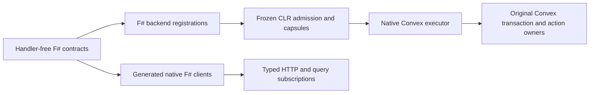

# Convex.FSharp architecture

The active SDK is native F#/.NET on this Convex backend fork. It preserves the
original Convex transaction, commit, identity, subscription and action owners.
Authored Fable, TypeScript and JavaScript lanes are retired.

Convex.Runtime owns the neutral invocation/declaration ABI. Convex.FSharp owns
canonical values, checked codecs, validators, schemas, references, registration
and context capabilities. Convex.DotNet owns frozen assembly admission, capsule
preparation and native deployment; its host composes the frontend. Application
policy belongs in application owners.

Query contexts provide reads. Mutation contexts provide transaction writes and
atomic scheduling. Action contexts own separately dispatched effects and calls;
a sequence of HTTP calls is not a native transaction. Query, mutation and import
code must pass deterministic admission, including actual callbacks and closed
receiver bodies. A framework method's name alone does not prove its callbacks
safe.

Canonical contracts retain argument/result types, function kind and visibility.
Automatic record/union representations preserve declared field names,
int64/float/bytes distinctions, absence versus null and document identities.
Custom representations must export their exact shared codec owner. Table names,
aliases, component paths, capsule versions and retained journal identities are
compatibility contracts.

Root build phases compile native assemblies, package capsules, generate
handler-free clients, compile clients and their declared client-hosts consumers,
then publish native F# WebAssembly. Upstream browser assets and the thin Tauri
Rust/Kotlin shell retain their own implementation languages. Capsule `.js`
carrier names hold versioned JSON; they do not restore an authored JS lane.

Read [integration](INTEGRATION.md), [capabilities](STATUS.md),
[quickstart](docs/quickstart.md) and
[implementation status](../IMPLEMENTATION_STATUS.md). Source architecture is
separate from compiled, packaged, installed and device acceptance.
